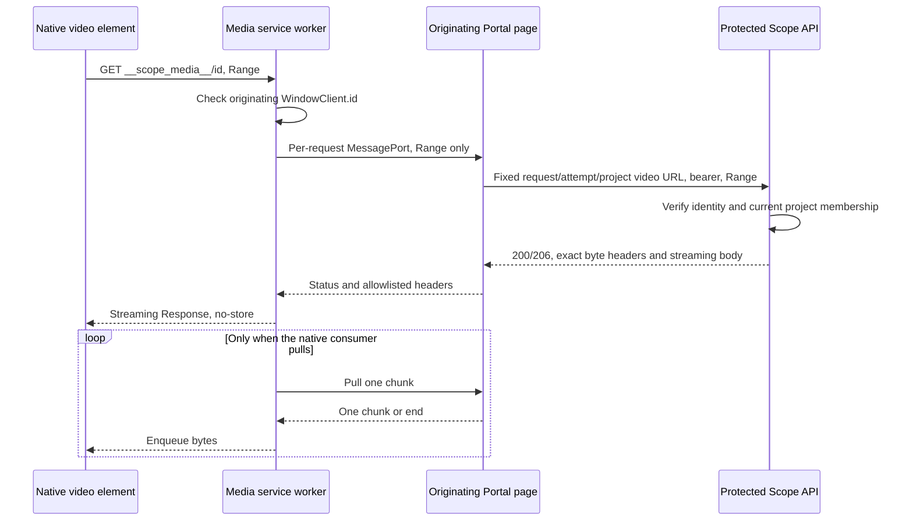

# Authenticated progressive recordings

`VideoPlayer` never assigns a protected API or stored blob URL directly to a
native `<video>` element. Browser media requests cannot use the Portal's bearer
injection hook. Fetching the entire recording into a blob would authenticate it,
but would sacrifice progressive loading and seeking.

Instead, a narrowly routed, same-origin service worker bridges native media
requests to the originating page. The page fetches each range through the
existing `fetchArtifact` / `apiClient` transport. It does not acquire its own
tokens or introduce signed URLs, cookie sessions, public blobs or an
authorization exception.

## Request and trust boundaries

The native video element requests a transient bridge route; only its originating
browser client can use that route:



- The page fixes the canonical URL, project, request/attempt and
  setup/iteration/index selectors when opening a bridge. The worker can request
  a range, not choose another upstream URL or project.
- The random bridge ID is **routing, not a capability**. Every fetch must have
  the same nonempty `FetchEvent.clientId` as the opening `WindowClient.id`.
  Other tabs, frames and navigations without that client ID fail closed.
  Opening messages and live clients must be same-origin; opening pages must also
  reside within the registration scope.
- Tokens remain ephemeral in the existing page transport. The worker receives
  no token, user profile or protected URL. Neither implementation writes protected
  bytes or handles to CacheStorage, IndexedDB or local storage.
- Each upstream request, including subsequent seeks and retries, passes normal
  API identity/project/parent guards. There is no authorization cache in the
  bridge. Removing membership prevents the **next** authorized range; bytes
  already buffered by a browser cannot be clawed back. An already-authorized
  range may finish until its session is canceled.

## Byte delivery and failures

Both current and historical video routes stream Azure blob bodies rather than
buffering the recording. Single explicit, open-ended and suffix ranges return
`206` with exact `Content-Range`, `Content-Length` and `Accept-Ranges: bytes`.
Ends beyond the recording are clamped. Invalid, multi-range or unsatisfiable
requests return `416` and `Content-Range: bytes */size` without downloading a blob.
Video selector values must be unambiguous nonnegative integer indexes, positive
integer iterations or `phase=setup`. Missing recordings return `404`.

The page validates progressive response headers and the requested byte interval.
The worker enforces message order and declared body length, rejecting malformed,
unsolicited, oversized or truncated chunks. It forwards only video delivery
headers and forces `Cache-Control: no-store`. Error responses retain their HTTP
status; `416` retains range metadata. Errors are displayed as text with a
deliberate **Retry recording** action, not saved or played as media.

Every native pull permits at most one `reader.read()` and one chunk on the
MessagePort; transferable streams are not required. The native response stream
has a zero high-water mark, and its `pull()` promise remains pending until the
chunk round trip completes. This serializes queued/concurrent native reads;
returning immediately would send overlapping requests while the page is still
reading a chunk. Cancellation, errors and timeouts settle that pending pull.
The shared HTTP client's response hook can introduce
a bounded transport prefetch; neither bridge implementation eagerly drains the
recording. Browser/network buffering is outside this protocol.

Transient establishment retries belong to `fetchArtifact`; the existing single
`401` refresh belongs to `apiClient`. The bridge adds no retry loop. A body failure
never silently restarts bytes from the beginning, and permanent `403`/`404` do
not request login. Worker/protocol timeouts abort the page fetch rather than
leaving an upstream stream running.

## Lifecycle and browser support

The shared artifact session supplies project/account/attempt identity and
cancellation. `VideoPlayer` immediately pauses and clears the native source on
session cancellation, and suppresses late URL publication. Unmount, retry,
identity changes and logout close ports, cancel body readers and abort fetches.
The page closes bridges on `pagehide`; the worker expires idle sessions after
five minutes. Opening/control acquisition is bounded to ten seconds each.
Unanswered range headers or outstanding chunk pulls time out after thirty
seconds; at most four ranges per bridge may be active.

Seeking cancels its old range without closing the recording session. A worker
controller change fails visibly and requires reopening. A browser may terminate
an idle service worker **earlier** than the five-minute application timeout;
worker memory is not durable. After restart a missing session is denied and the
native error presents a retry, rather than treating the ID as authorization.
No attempt is made to keep the worker alive indefinitely.

Support requires HTTPS (or a browser's trustworthy localhost exception), service
workers, MessageChannel, streaming responses, `AbortSignal.any` and
`crypto.randomUUID`. Unsupported environments and CSP/registration failures are
visible errors. There is no whole-file fallback.

The Portal refuses incompatible controlling or overlapping worker registrations,
including active, installing and waiting workers. It never unregisters or
replaces an unrelated worker. Storybook's root MSW worker is intentionally
incompatible; `VideoPlayer` stories exercise the real conflict and retry UI,
not a second root worker or simulated playback.

## Deployment

`apps/portal/public/scope-media-worker.js` must be deployed as JavaScript from
the same origin as the Portal. The shipped root-hosted nginx configuration:

- serves the exact `/scope-media-worker.js` asset without an SPA fallback, with
  `Cache-Control: no-store` and `X-Content-Type-Options: nosniff`, including errors;
- denies `/__scope_media__/...` at the server with no-store when no controlling
  worker intercepts it; a bridge URL must never become an HTML SPA success;
- streams same-origin API responses with proxy buffering/cache disabled.

Changing `public/` requires rebuilding the Portal image in source-mounted local
Compose; a TypeScript hot reload alone does not update this asset.

The client derives its worker script, scope and bridge URL from Vite's
`BASE_URL`; the worker derives its route from its actual registration scope.
The shipped nginx configuration is **root-hosted**. A deployment mounted under
a prefix must also configure Vite's base, serve the real JavaScript asset at
that prefix, deny the prefixed bridge route without SPA fallback, and keep API
artifact URLs same-origin. A base-path unit test is not proof of a prefixed
reverse proxy deployment.

An enforced CSP must permit the same-origin worker (`worker-src 'self'`), native
bridge media (`media-src 'self'`) and API fetches (`connect-src 'self'`, alongside
the Portal's existing trusted IdP connections). No `blob:` media permission,
wildcard source, broad service-worker scope or bearer in a URL is needed.
The dedicated worker does not intercept unrelated API/static/navigation paths.

## Focused executable checks

From the repository root:

```bash
pnpm exec vitest run apps/portal/src/lib/authenticated-media.test.ts apps/portal/src/components/VideoPlayer.test.tsx apps/portal/src/components/VideoPlayer.play.test.tsx apps/api/src/routes/requests/video.test.ts --reporter=default
pnpm --filter shared build
pnpm --filter portal exec tsc -b
pnpm --filter portal build
pnpm --filter portal build-storybook
```

The bridge suite executes the **deployed worker JavaScript**, using native
MessageChannels, Request/Response and ReadableStream objects, the real page
bridge and shared bearer/retry transport. API tests exercise both routes,
including a real test-server connection closed during an unfinished blob
stream. Player tests cover lifecycle, stale identities and StrictMode; composed
story play functions exercise conflict/retry and no-project states.
These are protocol/component checks, **not native browser playback evidence**.

## Required real-browser acceptance

Only the integration owner controls the shared local stack, real MSAL/emulator
accounts and isolated fixtures. Use an existing completed run or a clearly
identified representative WebM fixture; no new benchmark/worker execution is
needed. Record browser/version and whether media is fixture- or agent-produced.

1. Rebuild only local API/Portal as needed. Confirm the worker asset is JavaScript,
   no-store, not HTML; confirm uncontrolled bridge URLs return no-store `403`.
   Sign in normally through the emulator/MSAL and open a project recording.
2. Use a sufficiently long recording with network throttling to distinguish
   playback from full download. Capture metadata/duration and advancing
   `currentTime` **while the upstream transfer is still incomplete**. Do not
   infer progressiveness from `206` alone or claim success from protocol tests.
3. Seek beyond the currently buffered interval. Record the native bridge and
   upstream `Range` requests, exact `206` range/length headers, new playback time,
   and cancellation of the previous transfer. Cover top-level, setup,
   iteration/index and an explicit historical attempt.
4. Exercise expired-token single refresh, permanent `401`, `403`/`404`, `416`
   and an interrupted transfer. Verify visible errors, no auth loops, no whole
   file blob, no saved JSON error, no token in URLs/logs, and no protected cache
   entry or persisted bridge handle.
5. Copy a bridge URL into another tab and fetch it there: deny even while the
   original is playing. Repeat after page closure, worker restart and expiry.
   Exercise an incompatible worker without replacing it.
6. Remove membership using the normal isolated test workflow, then force a new
   range: deny it. Distinguish already-buffered bytes from newly authorized
   ranges. Restore only the fixture membership as appropriate.
7. While a range is active or pending, switch project/account/attempt, sign out,
   unmount/navigate, and trigger `pagehide`. Confirm the old native source,
   pending body reads and network transfer stop, and no late response attaches
   to the new selection.
8. Recheck existing authenticated log streaming/replay without submitting a new
   worker task. Test every supported browser engine before making a
   cross-browser support claim.
