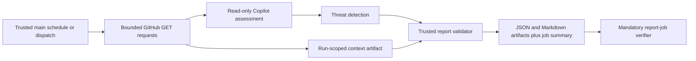

# Contribution Insights

Contribution Insights is a **report-only GitHub Agentic Workflows pilot** for
triaging human community pull requests. It separates value to Scope, evidence
of correctness, review readiness, risk, and confidence. It does not score
contributors or decide whether to merge their code.

The implementation is
[`.github/workflows/contribution-insights.md`](../../.github/workflows/contribution-insights.md),
compiled with **gh-aw v0.89.21** into the adjacent `.lock.yml`. The existing
maintenance workflows keep their own compiler versions.

## Implemented scope

Every captured PR receives all six P0 assessments:

| Scenario | Purpose |
| --- | --- |
| Value and scope fit | Identify the demonstrated problem and benefit; escalate undocumented product decisions. |
| Overlapping work | Compare bounded related issues/PRs; distinguish possible overlap from proven duplication. |
| Review-readiness intake | Apply the PR template, CLA evidence, documentation, and demos proportionately. |
| Behavioral evidence | Interpret captured checks and reproductions without inventing test execution or causality. |
| Scope completeness | Consider CLI/Portal parity, Storybook, compatibility, migrations, notices, docs, and prompt evaluations where applicable. |
| Reviewer brief and routing | Suggest CODEOWNERS, review order, uncertainties, and one/two-maintainer approval requirements. |

Markdown reports start with a TL;DR table showing the recommendation, separate
ratings, risk, confidence, contributor work, next action, and evidence caveat.
The table never presents a score as merge approval. It is derived from the
validated assessment and captured facts without another model call.

Feedback is drafted under **Required**, **Optional**, and **Needs maintainer
decision**. A required item should explain what to change, why, and how to
demonstrate resolution. Team-owned decisions must not become contributor chores.

Value and correctness evidence each receive an evidence-backed integer from
1 to 5, or `null` for unassessed. Risk and confidence are separate dimensions.
There is no combined score, automatic rejection threshold, or ready-to-merge
recommendation. High risk does not subtract from value.

The P1/P2 scenarios remain deferred: dedicated benchmark-integrity and
maintenance-cost assessments, revision-aware coaching, merge preflight, review
queue/lifecycle management, and post-merge calibration.

## Trust boundary and data flow

Only a schedule on upstream `main` or a maintainer's dispatch on upstream `main`
can activate the workflow. A trusted collector reads GitHub API data; the agent
cannot check out or execute the contribution. The report job validates output
against that exact snapshot before preserving it.



- All effective GitHub token permissions, including generated conclusion and
  system-output jobs, are read-only or empty.
- Shell execution, file editing, GitHub MCP tools, and CLI mounting are disabled
  for the analysis agent. Only report/diagnostic safe-output tools are exposed
  through MCP.
- Both code checkouts use the trusted workflow SHA, not a contributor branch.
  Checkout credentials are not persisted.
- PR text, paths, patches, comments, check names, and related items are untrusted
  data, never instructions. The `community-contribution` label is not an
  authorization or integrity-approval label.
- The collector reads first-time contributors directly through the API, avoiding
  GitHub MCP integrity defaults that would otherwise hide their contributions.
  This does not authorize executing their code.
- Common PAT, bearer, JWT, signed-URL, and private-key formats are redacted from
  captured contribution text. This is not a comprehensive secret scanner.
- System safe outputs are staged and issue/comment reporting is disabled.
  The custom artifact-only report job intentionally still runs. There are no
  approval, merge, label, assignment, branch-write, or closure outputs.
- A missing, invalid, duplicate, stale-snapshot, or failed report does not become
  a successful empty result. The report validator or mandatory verifier fails.
  A deliberately empty selection instead produces an explicit empty report.

Treat workflow logs, job summaries, and artifacts as public repository material.
Do not include private vulnerability details or sensitive data; follow
[`SECURITY.md`](../../SECURITY.md) instead.

## Selection, evidence, and limits

Selection follows the existing community labeler's human-author associations:
`NONE`, `FIRST_TIMER`, `FIRST_TIME_CONTRIBUTOR`, and `CONTRIBUTOR`. It does not
depend on that label already being applied. Bots and internal authors are excluded.

The daily batch considers the 100 most recently updated open PRs and selects
non-draft community PRs updated within 48 hours, newest first. The default batch
limit is 3; manual inputs allow 1-5. A targeted manual run accepts an open
community PR, including a draft, regardless of age. Closed/historical PR replay
is not implemented. Omitted eligible work and scan limits are explicit.

| Evidence | Bound |
| --- | --- |
| Files | First 100 files; changes beyond that remain unassessed |
| Textual patches | 3,000 characters per file, 24,000 per PR in total |
| PR description | 8,000 characters |
| Comments/reviews | First page of 100; last 10 entries from that captured page |
| Related items | Same-repository `#number`/GitHub links plus bounded title search; details for at most 5 |
| Checks/statuses | First 100 of each, requested for the exact captured head SHA |
| Complete serialized context | At most 256,000 UTF-8 bytes, including trusted policy files |

Missing patches, truncated data, unavailable evidence, and bounded search results
remain visible in the report. Confidence cannot be high with recorded evidence
limitations. Oversized contexts fail explicitly; reduce the batch or inspect the
contribution manually.

The collector re-reads each PR after collection and rejects a mixed snapshot if
its head/base SHA, update timestamp, eligibility, or open state changed. Reports
retain immutable head/base identifiers and the collection time; they are not
live checks and can become stale after collection.

Only the exact `license/cla` context from Microsoft GitHub Policy Service
establishes CLA evidence: GitHub App ID `95686`, or legacy status creator bot ID
`77245923`. Publisher IDs come from GitHub API metadata, not a check's name or
contributor text. Same-named checks from other publishers are explicitly
unassessed. A change of CLA provider requires a deliberate collector update.
Absent or inaccessible CLA evidence is unassessed, not proof the contributor
has not signed. Skipped, neutral, missing, pending, and inaccessible checks are
not passing test evidence. Passing public fork checks do not establish live-model
access. The pipeline does not run tests, establish required-check policy,
resolve inline review threads, or determine whether approvals are satisfied.

GitHub reads use the retry layer supplied by `actions/github-script`:
three retries, exempting permanent 400/401/403/404/422 responses, with a
30-second request timeout. Optional 403/404 evidence gaps become explicit
limitations; critical failures and exhausted transient failures fail the run.
There is no second retry wrapper.

## Operation

### Native local trial, before deployment

Use the local command to assess an open community PR without merging or
dispatching the workflow:

```bash
pnpm install --frozen-lockfile
gh auth status
copilot --version
pnpm contribution-insights:local --pr 1492
```

The command accepts the PR number or its canonical `microsoft/scope` GitHub URL.
It requires a recent installed Copilot CLI on `PATH`, Node/pnpm, and a
Copilot-entitled GitHub account. It does not require Docker, Python, a running
Scope stack, or an Actions secret. GitHub API reads and real Copilot inference
still use the network; local execution is not offline.

Authentication comes from `gh auth token`, captured in memory and never printed.
Optionally set `COPILOT_GITHUB_TOKEN` to use a separate inference credential;
the `gh` credential still supplies metadata reads. An explicitly supplied
inference token is not silently replaced if authentication fails. No `.env`
files are loaded.

The local runner reuses the same collector, workflow instructions, report
callback, validator, and renderer. The caller supplies the snapshot through the
owned top-level inline block, so the model does not need a file-reading tool.
It uses an empty-mode Copilot SDK session in a temporary home/working directory,
sanitizes inherited environment variables, disables ambient instructions,
skills, MCP, extensions, hooks, git context, session export, and persistence,
and verifies that the actual initialized tool graph contains only
`contribution_report` before inference. All other permission requests are
rejected. Session data is deleted and the runtime stopped after completion or
failure; inference failures are not automatically retried.

Unlike the hosted workflow, local credentials may have wider user permissions.
The metadata transport enforces API GET requests only, and the model has no
GitHub API or execution tools. This is not a reproduction of gh-aw's
container/firewall sandbox or hosted threat-detection job. Local runs explicitly
record `fidelity: "partial"`.

Successful runs save `context.json`, `report.json`, `report.md`, and `run.json`
under the ignored
`evaluations/static-prompts/results/contribution-insights-local/<run-id>/`
directory. The run record contains the resolved model, runtime version, token
counts, limits, head SHA, and captured policy hashes. Policies are taken from
the local working tree, not misrepresented as the base Git commit: their
citations point to the frozen `context.json`. Failed runs record a failed
`run.json` with redacted diagnostics rather than a successful empty assessment.

```bash
pnpm contribution-insights:local --pr 1492 --model auto \
  --timeout-seconds 180 --output ./tmp/pr-1492-local
pnpm contribution-insights:local --help
```

Relative output paths resolve from the repository root and must name a new
directory; existing reports are never overwritten. The default inference
timeout is 300 seconds (configurable from 1 to 1200), the model-turn limit is
20, and the CLI is started with a 200-AI-credit cap. There is no hosted daily
credit guard or Actions artifact retention locally. Review the local report
before deciding whether to enable the hosted pilot.

`gh aw run` dispatches GitHub Actions, and `gh aw trial` uses a GitHub trial
repository; neither is this native local mode.

### Hosted workflow

The hosted workflow must first be merged into upstream `main`. It uses the existing
`COPILOT_GITHUB_TOKEN` GitHub Actions secret for the Copilot engine. Tokens are
not supplied by contributors or exposed to their code.

Schedules are **disabled by default**. Set the repository Actions variable
`CONTRIBUTION_INSIGHTS_ENABLED=true` to opt into daily execution at **08:23 UTC**.
This is an Actions variable, not a Scope service environment variable.
Maintainer dispatches work without enabling the schedule:

```bash
gh workflow run contribution-insights.lock.yml \
  --repo microsoft/scope --ref main \
  -f pr_number=123 -f limit=1
```

Omit `pr_number` to use normal recent-PR selection. Limits are 20 agent turns,
20 minutes of agent execution, 200 AI credits per run, and 600 AI credits per day.
Runs are serialized. Standard gh-aw diagnostics and budget controls still apply.

Each successful run retains these artifacts for 14 days:

- `contribution-insights-context`: exact bounded input snapshot and trusted policies.
- `contribution-insights-report`: validated `report.json` and human-readable `report.md`.

The report job also writes the Markdown to its Actions job summary. Download a
report with:

```bash
gh run download RUN_ID --repo microsoft/scope \
  --name contribution-insights-report --dir contribution-insights-report
```

Review the advice and its evidence manually during the pilot. Contributor
feedback remains a draft, not a published comment. Scope's human approvals,
CLA, required checks, and merge policy remain unchanged. Hosted model-quality
calibration and any future publishing require a separate deliberate rollout.

## Maintenance and verification

Helpers use native TypeScript `.mts` modules supported by the Node 24
`actions/github-script` runtime, without installing repository dependencies or
running lifecycle hooks in Actions. Their co-located tests run in normal CI;
workflow/helper path filters select them. `.mts` is covered by the license-header
checker.

Compile only this workflow using v0.89.21:

```bash
gh aw compile contribution-insights --actionlint
pnpm exec vitest run scripts/contribution-insights/collect.test.ts \
  scripts/contribution-insights/report.test.ts \
  scripts/contribution-insights/workflow.test.ts scripts/ci-workflow.test.ts
```

Review generated permissions, action/container pins, custom-job conditions,
and shared compiler metadata. Preserve the older workflows' action-lock entries
and the repository's `.gitattributes` merge policy when the compiler rewrites
shared files. Never edit generated `.lock.yml` by hand.

The `contribution-insights/default` static-prompt family has eight synthetic
contract cases and a production-backed adapter. See
[Prompt Evaluations](prompt-evaluations.md) for its rubric, fidelity limitations,
and explicit developer-run commands. Offline fake-model evaluation checks
plumbing and deterministic contracts, not the quality of actual AI assessments.
Local runner/isolation contracts run with
`pnpm --filter static-prompt-evals test:ts`.
