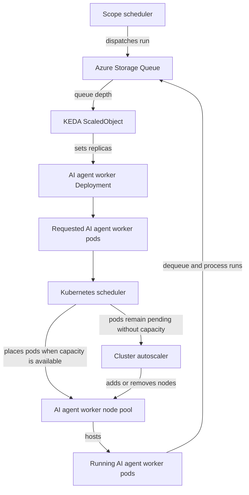

Scope's production/reference architecture uses two coordinated Kubernetes
scaling layers. [KEDA](https://keda.sh/) scales queue-consuming AI
coding-agent worker pods, while the Kubernetes cluster autoscaler supplies
the node-pool capacity those pods need.

An **AI coding-agent worker** is the Kubernetes workload that launches a
coding agent such as GitHub Copilot or Claude Code to execute a Scope run.
Other queue consumers, including post-run processors, can use the same KEDA
scaling pattern.

## Scaling flow

The Scope scheduler dispatches each run to the Azure Storage Queue assigned
to its AI coding-agent worker type. The
[KEDA Azure Storage Queue scaler](https://keda.sh/docs/latest/scalers/azure-storage-queue/)
watches that queue and changes the corresponding AI coding-agent worker
Deployment's replica count. Kubernetes then schedules the requested pods
onto a compatible worker node pool. Only after a pod is running on a node can
it dequeue and process runs.

## Scale AI coding-agent worker pods with KEDA

Each queue-driven AI coding-agent worker has a KEDA
[`ScaledObject`](https://keda.sh/docs/latest/reference/scaledobject-spec/)
associated with its Azure Storage Queue. As queued work arrives, KEDA
increases the worker Deployment's desired replica count within that worker's
configured limits. Each pod launches the selected coding agent and processes
runs for its worker type.

When the queue drains and the cooldown period expires, KEDA reduces the
replica count. Queue consumers can
[scale to zero](https://keda.sh/docs/latest/concepts/scaling-deployments/)
when they are idle, avoiding AI coding-agent compute cost when Scope has no
runs for them.

Polling intervals, cooldowns, and replica limits are deployment settings.
They can differ by worker because AI coding agents and post-run processors
have different resource and concurrency requirements.

## Scale AI coding-agent worker node pools

KEDA does not scale node pools directly. It creates demand by increasing the
number of worker pods. The Kubernetes scheduler first tries to place those
pods on compatible nodes.

If pods remain pending because an AI coding-agent worker node pool lacks
capacity, the cluster autoscaler can add nodes to that pool. When KEDA later
removes idle agent worker pods and nodes become unneeded, the cluster
autoscaler can remove the excess nodes.

Node selectors, taints, tolerations, operating-system requirements, and
resource requests determine which node pool can host each AI coding-agent
worker. Configure those scheduling constraints and the cluster autoscaler's
minimum and maximum node counts together so every AI coding-agent worker has
an eligible pool.

## Current self-hosting quickstart

The public [Helm chart](https://helm.sh/docs/topics/charts/) and Azure
quickstart documented here do not install KEDA or configure cluster
autoscaling yet. They use fixed Deployment replica counts and fixed AKS node
counts.

Use [Operations](/self-hosting/operations/#scale) to change application
replicas and [Node pools](/self-hosting/provision-aks/#node-pools) to change
the currently shipped AKS pool sizes.
